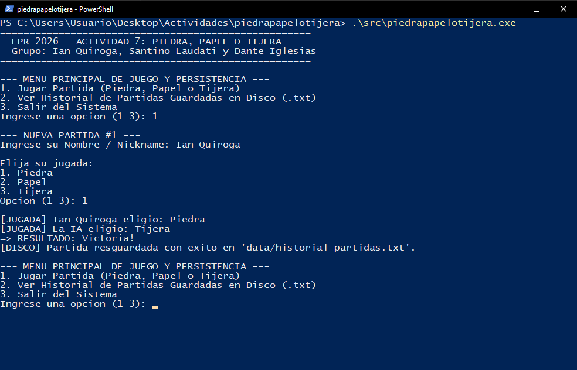
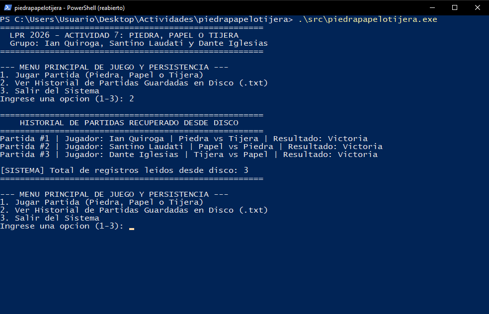

# 1. Presentación

**Piedra, Papel o Tijera** es un juego de consola en el que competís contra la computadora. Cada partida se guarda automáticamente, así que podés cerrar el juego y, la próxima vez que lo abras, ver todas las partidas anteriores.

# 2. Cómo iniciar el juego

1. Abrí la carpeta `piedrapapelotijera` en Visual Studio Code y abrí la terminal (**Ctrl + Ñ**).
2. Compilá (solo la primera vez):

```powershell
g++ -std=c++11 src/main.cpp -o src/piedrapapelotijera.exe
```

3. Ejecutá:

```powershell
.\src\piedrapapelotijera.exe
```

# 3. Menú principal

| Opción | Acción |
|---|---|
| 1 | Jugar una partida |
| 2 | Ver el historial de partidas guardadas |
| 3 | Salir |

Escribí el número de la opción y presioná **Enter**.

# 4. Jugar una partida

1. Elegí la opción **1**.
2. Escribí tu nombre o apodo y presioná Enter (no uses comas).
3. Elegí tu jugada: **1** Piedra, **2** Papel o **3** Tijera.
4. La computadora elige al azar y se muestra el resultado: **Victoria**, **Derrota** o **Empate**.
5. El mensaje `[DISCO] Partida resguardada con exito` confirma que se guardó.



**Reglas:** Piedra le gana a Tijera, Tijera le gana a Papel y Papel le gana a Piedra.

# 5. Ver el historial

Elegí la opción **2**. Se listan todas las partidas guardadas, incluso las de días anteriores, con el total de registros.



# 6. Dónde se guardan los datos

En el archivo `data/historial_partidas.txt`. Se puede abrir con el Bloc de notas o con Excel. Para empezar un historial nuevo, borrá ese archivo (se vuelve a crear solo en la próxima partida).

# 7. Problemas frecuentes

| Problema | Solución |
|---|---|
| "Opcion invalida" | Escribí solo 1, 2 o 3. |
| "Aun no existen partidas guardadas" | Todavía no jugaste ninguna partida: elegí la opción 1. |
| El historial no aparece | Ejecutá el juego desde la carpeta raíz `piedrapapelotijera`, no desde `src`. |
| No me deja compilar en la PC de la escuela | Usá OnlineGDB y copiá el código de `src/main.cpp`. |
